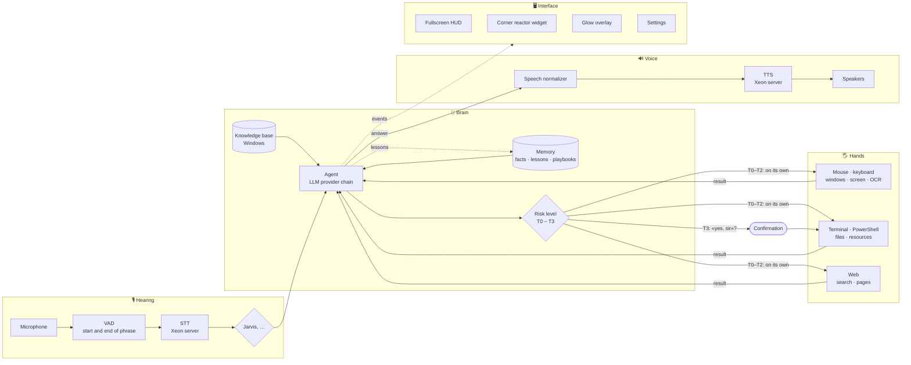

# J.A.R.V.I.S.

[Русский](README.md) · **English** · [Română](README.ro.md)

A voice assistant for Windows 11 inspired by J.A.R.V.I.S. from *Iron Man*. Say "Jarvis, …" — it listens, thinks and answers with a live voice. It can control the PC with the mouse and keyboard (with an on-screen glow so you can see what it is doing), search the web, answer from the Windows documentation, remember you and learn from its own mistakes.

Stack: **Rust + Tauri 2 + Next.js**. No Python in the project. The detailed plan and decisions are in [docs/PLAN.md](docs/PLAN.md) (in Russian).

> Status: in development. Modules are written and tested one by one; they are not yet assembled into a single application (the integration stage is next).

## How it works



All modules are built on the shared crate [`crates/jarvis-core`](crates/jarvis-core): event, tool, LLM and config types, plus the STT protocol.

## Modules and status

| Module | Folder | What it does | Status | Tests |
|---|---|---|---|---|
| Core | [crates/jarvis-core](crates/jarvis-core) | shared contracts | ✅ | 14 |
| Brain | [crates/jarvis-agent](crates/jarvis-agent) | "observe → act → verify" loop, confirmations, glow | ✅ | 46 |
| LLM providers | [crates/jarvis-llm](crates/jarvis-llm) | 16 providers (Groq, OpenCode Zen, OpenRouter, OpenAI, Anthropic, Gemini…), key validation, best-model selection, failover chain | ✅ | 69 (+3 live) |
| Web | [crates/jarvis-web](crates/jarvis-web) | search (DuckDuckGo without a key, Brave, Tavily…), page reading, research with sources, protection from malicious "instructions" | ✅ | 64 (+2 live) |
| PC | [crates/jarvis-pc](crates/jarvis-pc) | mouse, keyboard, UI Automation, screenshots with marks, OCR, terminal | ✅ | 83 (+8 live input) |
| Knowledge base | [crates/jarvis-kb](crates/jarvis-kb), [tools/kb-build](tools/kb-build), [kb/seed](kb/seed) | ~20k chunks of Microsoft documentation + cheat sheets; Recall@5 = 95.4 % | ✅ | 72 |
| Interface | [src](src), [src-tauri](src-tauri) | HUD, corner reactor widget, glow overlay, settings, demo simulator | ✅ (not yet tested live) | 39 + 25 |
| Voice | [crates/jarvis-voice](crates/jarvis-voice) | TTS client, speech normalizer, VAD, "Jarvis / stop / yes", echo filter, STT clients | 🟡 no speakers, microphone or pipeline yet | 54 (+3 live) |
| Memory | [crates/jarvis-memory](crates/jarvis-memory) | facts, lessons from mistakes, playbooks, self-learning | ⏸ in progress | — |
| System | [crates/jarvis-sys](crates/jarvis-sys) | command risk levels, PowerShell, undo, resources, search and open | ⏸ in progress | — |
| STT server | [server/jarvis-stt-rs](server/jarvis-stt-rs) | Russian speech recognition on the Xeon | ⏸ in progress | — |
| TTS server | [server/jarvis-tts-rs](server/jarvis-tts-rs) | `jarvis-ru` voice synthesis (running on the Xeon) | ✅ running | — |

"Live" tests go to the network or move the mouse and are skipped by default (`#[ignore]`).

## Voice server (Xeon 192.168.50.38)

- **TTS**: `https://192.168.50.38:8443`, no token, TLS with a private CA ([src-tauri/config/xeon-tts-ca.pem](src-tauri/config/xeon-tts-ca.pem)). `GET /ready`, `POST /tts/stream` → 24 kHz PCM. The model is downloaded from the server into `server/jarvis-tts-rs/model/` (not stored in git).
- **STT**: will be at `https://192.168.50.38:8444`; protocol — [crates/jarvis-core/src/stt_protocol.rs](crates/jarvis-core/src/stt_protocol.rs).

## Configuration

Everything lives in a single `config.json` in the project root (in `.gitignore`, never committed). A sample without secrets is [config.example.json](config.example.json):

```powershell
copy config.example.json config.json
```

It holds the LLM providers and keys, model chains per role (`brain`, `fast`, `vision`, `reflection`), search, TTS/STT addresses, permissions (`autonomy`: `ask_dangerous` — ask only about dangerous actions) and the window mode.

Jarvis's data (memory, knowledge base, undo journal) lives in `data/` (also outside git).

## Running and testing

Requirements: Rust (stable), Node.js 24, WebView2, `cargo install tauri-cli`.

```powershell
# interface with the demo simulator (backend not wired yet)
npm install
cargo tauri dev

# module tests (each crate builds separately)
cd crates\jarvis-agent; cargo test
npm test                     # frontend tests

# Windows knowledge base
cd tools\kb-build; cargo run --release -- --offline   # rebuild from what is already downloaded
cargo run --release -- --eval                          # measure accuracy
```

Hotkeys: **Ctrl+Alt+J** — fullscreen HUD / corner, **Ctrl+Alt+K** — emergency stop.

## Security

- Actions are split into levels: **T0** read, **T1** action (with glow), **T2** changes in the user profile (with undo), **T3** dangerous — Jarvis says what it is about to do and waits for "yes, sir". An unknown command is treated as dangerous.
- Text from websites, the terminal and the screen is data, not commands: Jarvis does not follow "instructions" found there.
- Keys and passwords are stripped from text before it is sent to the cloud.
- Keys are stored only in `config.json` and are masked in the interface and logs.

## Next steps

1. Finish Memory, System, Voice and the STT server.
2. Integration: wire the real modules in place of the interface's demo data, build a shared Cargo workspace.
3. End-to-end tests against the acceptance criteria in [docs/PLAN.md](docs/PLAN.md), first live run.
