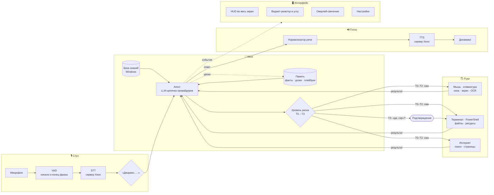

# J.A.R.V.I.S.

**Русский** · [English](README.en.md) · [Română](README.ro.md)

Голосовой ассистент для Windows 11 в духе Джарвиса из «Железного человека». Говоришь «Джарвис, …» — он слушает, думает и отвечает живым голосом. Умеет управлять ПК мышью и клавиатурой (со свечением, чтобы было видно, что он делает), искать в интернете, отвечать по документации Windows, помнить тебя и учиться на своих ошибках.

Стек: **Rust + Tauri 2 + Next.js**. Python в проекте нет. Подробный план и решения — [docs/PLAN.md](docs/PLAN.md).

> Статус: идёт разработка. Модули пишутся отдельно и тестируются по одному, общей сборки в одно приложение ещё нет (этап интеграции впереди).

## Как это устроено



Все модули опираются на общий крейт [`crates/jarvis-core`](crates/jarvis-core): типы событий, инструментов, LLM, конфига и протокол STT.

## Модули и статус

| Модуль | Папка | Что делает | Статус | Тесты |
|---|---|---|---|---|
| Ядро | [crates/jarvis-core](crates/jarvis-core) | общие контракты | ✅ | 14 |
| «Мозг» | [crates/jarvis-agent](crates/jarvis-agent) | цикл «наблюдай → действуй → проверь», подтверждения, свечение | ✅ | 46 |
| LLM-провайдеры | [crates/jarvis-llm](crates/jarvis-llm) | 16 провайдеров (Groq, OpenCode Zen, OpenRouter, OpenAI, Anthropic, Gemini…), проверка ключа, подбор лучших моделей, запасная цепочка | ✅ | 69 (+3 живых) |
| Интернет | [crates/jarvis-web](crates/jarvis-web) | поиск (DuckDuckGo без ключа, Brave, Tavily…), чтение страниц, исследование с источниками, защита от вредных «инструкций» | ✅ | 64 (+2 живых) |
| ПК | [crates/jarvis-pc](crates/jarvis-pc) | мышь, клавиатура, UI Automation, скриншоты с метками, OCR, терминал | ✅ | 83 (+8 живого ввода) |
| База знаний | [crates/jarvis-kb](crates/jarvis-kb), [tools/kb-build](tools/kb-build), [kb/seed](kb/seed) | ~20 тыс. фрагментов документации Microsoft + шпаргалки; Recall@5 = 95,4 % | ✅ | 72 |
| Интерфейс | [src](src), [src-tauri](src-tauri) | HUD, виджет-реактор в углу, оверлей-свечение, настройки, демо-симулятор | ✅ (не проверен вживую) | 39 + 25 |
| Голос | [crates/jarvis-voice](crates/jarvis-voice) | TTS-клиент, нормализатор речи, VAD, «Джарвис/стоп/да», фильтр эха, STT-клиенты | 🟡 нет динамиков, микрофона и связки | 54 (+3 живых) |
| Память | [crates/jarvis-memory](crates/jarvis-memory) | факты, уроки-ошибки, плейбуки, самообучение | ⏸ в работе | — |
| Система | [crates/jarvis-sys](crates/jarvis-sys) | уровни риска команд, PowerShell, откат, ресурсы, поиск и открытие | ⏸ в работе | — |
| STT-сервер | [server/jarvis-stt-rs](server/jarvis-stt-rs) | распознавание русской речи на Xeon | ⏸ в работе | — |
| TTS-сервер | [server/jarvis-tts-rs](server/jarvis-tts-rs) | синтез голоса `jarvis-ru` (работает на Xeon) | ✅ работает | — |

«Живые» тесты ходят в сеть или двигают мышь и по умолчанию пропускаются (`#[ignore]`).

## Сервер голоса (Xeon 192.168.50.38)

- **TTS**: `https://192.168.50.38:8443`, без токена, TLS частным CA ([src-tauri/config/xeon-tts-ca.pem](src-tauri/config/xeon-tts-ca.pem)). `GET /ready`, `POST /tts/stream` → PCM 24 кГц. Модель скачивается с сервера в `server/jarvis-tts-rs/model/` (в git не хранится).
- **STT**: будет на `https://192.168.50.38:8444`, протокол — [crates/jarvis-core/src/stt_protocol.rs](crates/jarvis-core/src/stt_protocol.rs).

## Конфигурация

Всё в одном файле `config.json` в корне проекта (в `.gitignore`, не коммитится). Образец без секретов — [config.example.json](config.example.json):

```powershell
copy config.example.json config.json
```

Там провайдеры LLM и ключи, цепочки моделей по ролям (`brain`, `fast`, `vision`, `reflection`), поиск, адреса TTS/STT, разрешения (`autonomy`: `ask_dangerous` — спрашивать только про опасное), режим окон.

Данные Джарвиса (память, база знаний, журнал отката) лежат в `data/` (тоже вне git).

## Запуск и тесты

Нужно: Rust (stable), Node.js 24, WebView2, `cargo install tauri-cli`.

```powershell
# интерфейс с демо-симулятором (бэкенд пока не подключён)
npm install
cargo tauri dev

# тесты модуля (каждый крейт собирается отдельно)
cd crates\jarvis-agent; cargo test
npm test                     # тесты фронтенда

# база знаний Windows
cd tools\kb-build; cargo run --release -- --offline   # пересобрать из уже скачанного
cargo run --release -- --eval                          # замер точности
```

Горячие клавиши: **Ctrl+Alt+J** — HUD во весь экран / в угол, **Ctrl+Alt+K** — аварийная остановка.

## Безопасность

- Действия делятся на уровни: **T0** чтение, **T1** действие (со свечением), **T2** изменения в профиле (с откатом), **T3** опасное — Джарвис говорит, что сделает, и ждёт «да, сэр». Неизвестная команда считается опасной.
- Текст с сайтов, из терминала и с экрана — это данные, а не команды: Джарвис не выполняет «инструкции», найденные там.
- Перед отправкой в облако из текста вырезаются ключи и пароли.
- Ключи хранятся только в `config.json`, в интерфейсе и логах маскируются.

## Что дальше

1. Доделать Память, Систему, Голос и STT-сервер.
2. Интеграция: подключить настоящие модули вместо демо-данных в интерфейсе, собрать общий Cargo workspace.
3. Общие тесты по критериям приёмки из [docs/PLAN.md](docs/PLAN.md), первый живой запуск.
