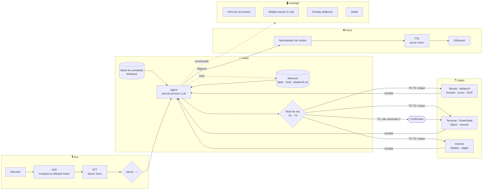

# J.A.R.V.I.S.

[Русский](README.md) · [English](README.en.md) · **Română**

Un asistent vocal pentru Windows 11 inspirat de J.A.R.V.I.S. din *Iron Man*. Spui „Jarvis, …” — el ascultă, gândește și răspunde cu voce vie. Poate controla PC-ul cu mouse-ul și tastatura (cu o strălucire pe ecran, ca să vezi ce face), caută pe internet, răspunde din documentația Windows, ține minte cine ești și învață din propriile greșeli.

Stack: **Rust + Tauri 2 + Next.js**. Fără Python în proiect. Planul detaliat și deciziile sunt în [docs/PLAN.md](docs/PLAN.md) (în rusă).

> Stare: în dezvoltare. Modulele sunt scrise și testate pe rând; încă nu sunt asamblate într-o singură aplicație (urmează etapa de integrare).

## Cum funcționează



Toate modulele se bazează pe crate-ul comun [`crates/jarvis-core`](crates/jarvis-core): tipurile de evenimente, instrumente, LLM și configurație, plus protocolul STT.

## Module și stare

| Modul | Folder | Ce face | Stare | Teste |
|---|---|---|---|---|
| Nucleu | [crates/jarvis-core](crates/jarvis-core) | contracte comune | ✅ | 14 |
| Creier | [crates/jarvis-agent](crates/jarvis-agent) | ciclul „observă → acționează → verifică”, confirmări, strălucire | ✅ | 46 |
| Furnizori LLM | [crates/jarvis-llm](crates/jarvis-llm) | 16 furnizori (Groq, OpenCode Zen, OpenRouter, OpenAI, Anthropic, Gemini…), verificarea cheii, alegerea celor mai bune modele, lanț de rezervă | ✅ | 69 (+3 live) |
| Internet | [crates/jarvis-web](crates/jarvis-web) | căutare (DuckDuckGo fără cheie, Brave, Tavily…), citirea paginilor, cercetare cu surse, protecție împotriva „instrucțiunilor” malițioase | ✅ | 64 (+2 live) |
| PC | [crates/jarvis-pc](crates/jarvis-pc) | mouse, tastatură, UI Automation, capturi de ecran cu marcaje, OCR, terminal | ✅ | 83 (+8 intrare live) |
| Bază de cunoștințe | [crates/jarvis-kb](crates/jarvis-kb), [tools/kb-build](tools/kb-build), [kb/seed](kb/seed) | ~20 mii de fragmente din documentația Microsoft + fișe; Recall@5 = 95,4 % | ✅ | 72 |
| Interfață | [src](src), [src-tauri](src-tauri) | HUD, widget-reactor în colț, overlay-strălucire, setări, simulator demo | ✅ (netestată live) | 39 + 25 |
| Voce | [crates/jarvis-voice](crates/jarvis-voice) | client TTS, normalizator de vorbire, VAD, „Jarvis / stop / da”, filtru de ecou, clienți STT | 🟡 fără difuzoare, microfon și lanț complet | 54 (+3 live) |
| Memorie | [crates/jarvis-memory](crates/jarvis-memory) | fapte, lecții din greșeli, playbook-uri, auto-învățare | ⏸ în lucru | — |
| Sistem | [crates/jarvis-sys](crates/jarvis-sys) | niveluri de risc ale comenzilor, PowerShell, anulare, resurse, căutare și deschidere | ⏸ în lucru | — |
| Server STT | [server/jarvis-stt-rs](server/jarvis-stt-rs) | recunoașterea vorbirii în rusă pe Xeon | ⏸ în lucru | — |
| Server TTS | [server/jarvis-tts-rs](server/jarvis-tts-rs) | sinteza vocii `jarvis-ru` (rulează pe Xeon) | ✅ funcționează | — |

Testele „live” accesează rețeaua sau mișcă mouse-ul și sunt sărite implicit (`#[ignore]`).

## Serverul de voce (Xeon 192.168.50.38)

- **TTS**: `https://192.168.50.38:8443`, fără token, TLS cu CA privat ([src-tauri/config/xeon-tts-ca.pem](src-tauri/config/xeon-tts-ca.pem)). `GET /ready`, `POST /tts/stream` → PCM 24 kHz. Modelul se descarcă de pe server în `server/jarvis-tts-rs/model/` (nu se păstrează în git).
- **STT**: va fi la `https://192.168.50.38:8444`; protocolul — [crates/jarvis-core/src/stt_protocol.rs](crates/jarvis-core/src/stt_protocol.rs).

## Configurare

Totul se află într-un singur fișier `config.json` în rădăcina proiectului (în `.gitignore`, nu se comite). Un exemplu fără secrete este [config.example.json](config.example.json):

```powershell
copy config.example.json config.json
```

Acolo sunt furnizorii LLM și cheile, lanțurile de modele pe roluri (`brain`, `fast`, `vision`, `reflection`), căutarea, adresele TTS/STT, permisiunile (`autonomy`: `ask_dangerous` — întreabă doar despre acțiunile periculoase) și modul ferestrelor.

Datele lui Jarvis (memorie, bază de cunoștințe, jurnal de anulare) se află în `data/` (tot în afara git).

## Pornire și teste

Necesar: Rust (stable), Node.js 24, WebView2, `cargo install tauri-cli`.

```powershell
# interfața cu simulatorul demo (backend-ul nu este încă conectat)
npm install
cargo tauri dev

# testele unui modul (fiecare crate se compilează separat)
cd crates\jarvis-agent; cargo test
npm test                     # teste frontend

# baza de cunoștințe Windows
cd tools\kb-build; cargo run --release -- --offline   # reconstruire din ce e deja descărcat
cargo run --release -- --eval                          # măsurarea preciziei
```

Taste rapide: **Ctrl+Alt+J** — HUD pe tot ecranul / în colț, **Ctrl+Alt+K** — oprire de urgență.

## Securitate

- Acțiunile sunt împărțite pe niveluri: **T0** citire, **T1** acțiune (cu strălucire), **T2** modificări în profilul utilizatorului (cu anulare), **T3** periculos — Jarvis spune ce urmează să facă și așteaptă „da, domnule”. O comandă necunoscută este considerată periculoasă.
- Textul de pe site-uri, din terminal și de pe ecran este dată, nu comandă: Jarvis nu execută „instrucțiunile” găsite acolo.
- Cheile și parolele sunt eliminate din text înainte de a fi trimis în cloud.
- Cheile se păstrează doar în `config.json` și sunt mascate în interfață și în jurnale.

## Pașii următori

1. Finalizarea modulelor Memorie, Sistem, Voce și a serverului STT.
2. Integrare: conectarea modulelor reale în locul datelor demo din interfață, un workspace Cargo comun.
3. Teste end-to-end după criteriile de acceptare din [docs/PLAN.md](docs/PLAN.md), prima pornire live.
